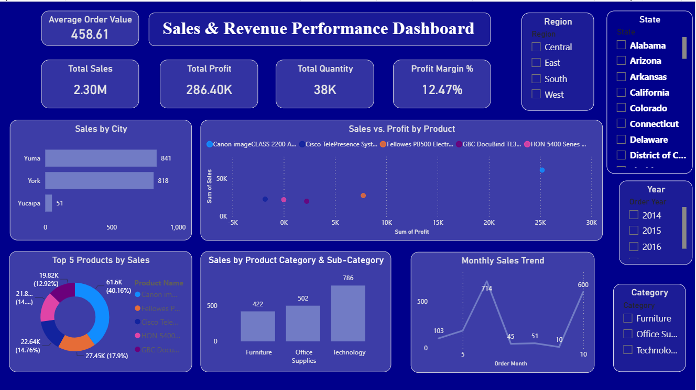

# Sales & Revenue Performance Dashboard

## Project Overview

This project presents an interactive Sales & Revenue Performance Dashboard built using Microsoft Power BI.

The dashboard provides insights into sales performance, profitability, product categories, and customer purchasing trends through interactive visualizations.

The dashboard features a premium black and gold theme for a clean and professional look.

## Dashboard Preview



## Key Features

- **Total Sales:** Monitor overall sales revenue.
- **Total Profit:** Analyze total profit generated.
- **Total Quantity:** Track the quantity of products sold.
- **Profit Margin:** Understand profitability as a percentage.
- **Average Order Value:** Measure the average revenue per order.
- **Sales by City:** Compare sales performance across cities.
- **Sales by Category:** Analyze sales across Furniture, Office Supplies, and Technology.
- **Monthly Sales Trend:** Track sales performance over time.
- **Top 5 Products:** Identify the highest-selling products.
- **Sales vs. Profit:** Compare product-level sales and profitability.

## Interactive Filters

The dashboard includes interactive slicers to filter data by:

- Year
- Region
- Product Category
- State

These filters allow users to explore sales performance across different business dimensions.

## Tools & Technologies

- Microsoft Power BI
- Power Query
- DAX
- Data Visualization

## Dashboard Theme

The dashboard uses a premium black and gold color palette.

| Element | Color |
|---|---|
| Background | `#100900` |
| Card Background | `#261800` |
| Gold Accent | `#FFC02E` |
| Main Text | `#FFE6A0` |
| Chart Labels | `#FFFFFF` |

## Project Structure

```text
Sales-Revenue-Dashboard/
│
├── README.md
├── dashboard.png
└── Sales-Revenue-Dashboard.pbix
```

## How to Use

1. Clone or download this repository.
2. Open the `.pbix` file using Microsoft Power BI Desktop.
3. Explore the dashboard using the interactive slicers.
4. Analyze sales, profit, and product performance.

## Project Objective

The objective of this project is to transform sales data into meaningful business insights through interactive data visualization and performance analysis.

## Author

Created as a Power BI data analytics project.
